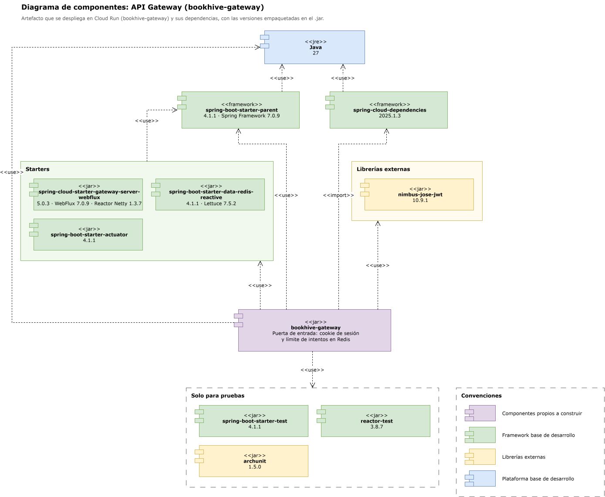
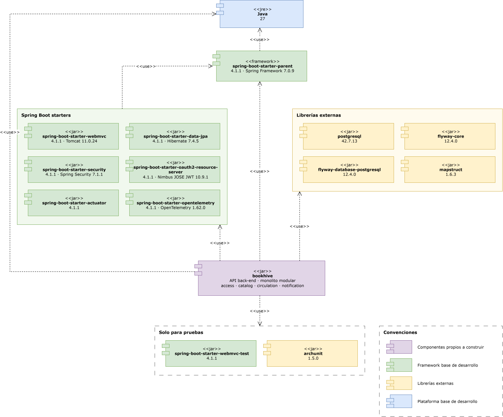
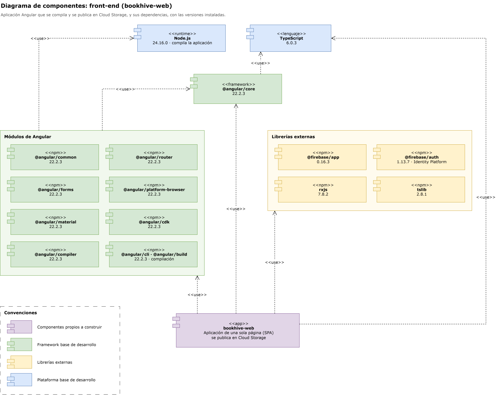
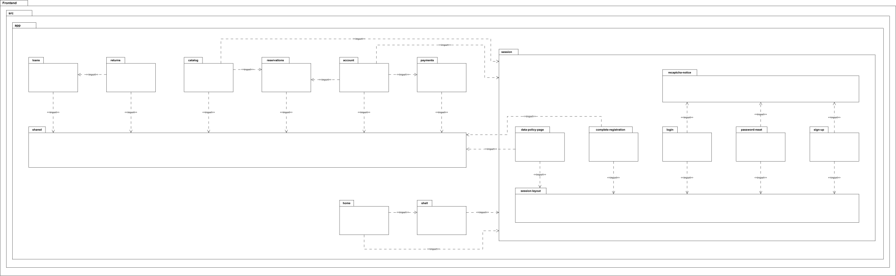
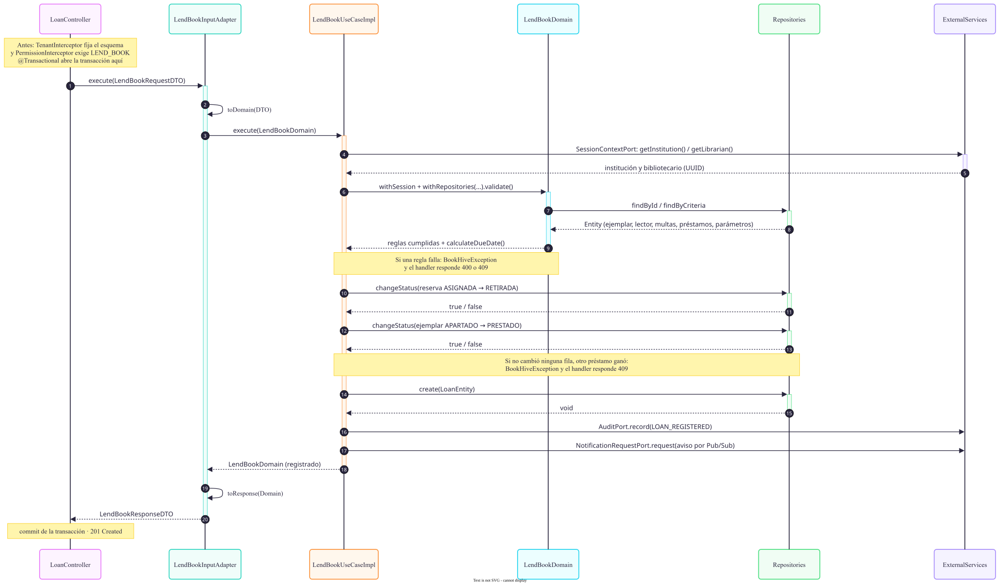

# BookHive

Descripción breve del proyecto.

## Diagramas

Todos los diagramas están en la carpeta [docs/diagramas](docs/diagramas).

### Diagrama de componentes

#### API Gateway

#### Backend

#### Frontend

### Diagrama de paquetes

#### Backend

#### Frontend

### Flujo de backend

